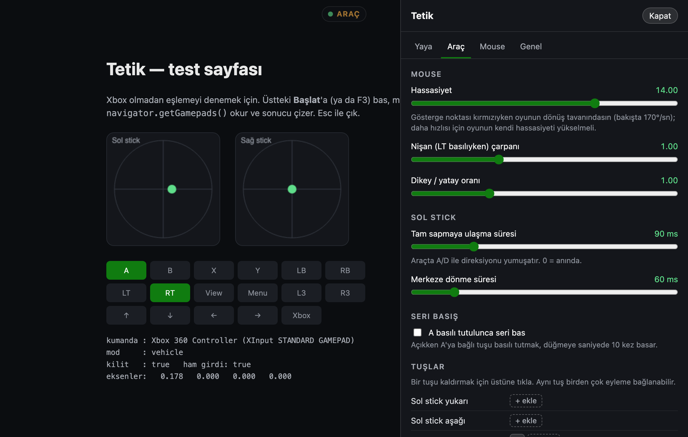
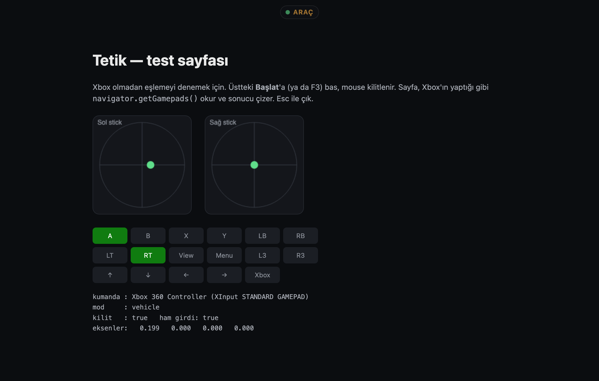
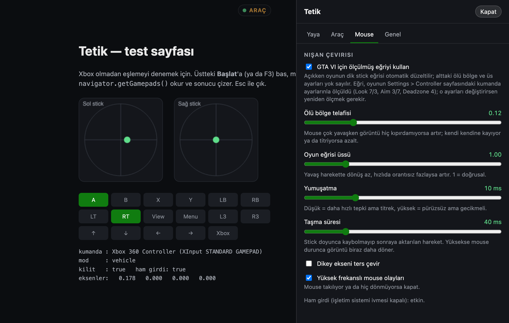

# Tetik

**English** · [Türkçe](README.tr.md)

A Chrome extension that lets you play Xbox Remote Play / Xbox Cloud Gaming in the browser with a keyboard and mouse. It presents a virtual Xbox controller to the page and translates your input into stick and button state.

It was built for one specific annoyance: in games like GTA, `W` has to mean "left stick forward" on foot and "right trigger" in a car, and a plain key-to-button mapper cannot know which one you need.

> Unofficial project. Not affiliated with, endorsed by, or connected to Microsoft, Xbox, or Rockstar Games. All trademarks belong to their owners.



## What it does

- **On-foot and vehicle profiles.** Each has its own key bindings, mouse sensitivity and steering ramp. Held keys are re-evaluated when the profile changes, so holding `W` while entering a car turns into throttle without releasing the key.
- **Automatic vehicle detection (GTA VI).** The "enter vehicle" button is also the "interact / pick up" button, so the extension does not switch on the key press. It watches the stream for the vehicle name card that appears above the minimap when you actually sit in a vehicle, and switches then.
- **Mouse aim that keeps distance consistent.** Mouse counts are converted to a turn rate and unused counts carry over to the next poll, so the same hand movement gives the same turn angle (until the stick saturates at the game's maximum turn rate).
- **Measured response curves.** Games apply a dead zone and a non-linear curve to the right stick. The extension ships with curves measured in GTA VI and inverts them, including separate curves for free look and aiming and a correction for different horizontal and vertical speeds.
- **Raw mouse input.** Pointer lock is requested with `unadjustedMovement`, which bypasses OS pointer acceleration.
- **In-page settings panel.** Bindings, sensitivities and curve options can be changed while the stream is running. Settings can be exported and imported as JSON.

## Screenshots

The screenshots show the bundled test page, not a game. The panel is the same one that opens over the stream.

| Vehicle profile: `W` is the right trigger, `Space` the handbrake | Mouse translation settings |
|---|---|
|  |  |

## Install

There is no store listing; load it unpacked.

1. Download or clone this repository.
2. Open `chrome://extensions` and turn on **Developer mode**.
3. Click **Load unpacked** and select the repository folder.
4. Disable any other keyboard-and-mouse extension for Xbox streaming. Two extensions patching the gamepad API at once will conflict.
5. Open `https://www.xbox.com/play` or `https://play.xbox.com` and start a stream.

Requires Chrome 111 or newer (or another Chromium browser with Manifest V3 `world: "MAIN"` content scripts).

## Use

| Key | Action |
|---|---|
| `F3` | Start or stop capture. Stopping only releases the mouse; the virtual controller stays connected. |
| `Esc` | Releases the mouse (browser behaviour). In fullscreen it is sent to the game as Menu instead. |
| `Alt+R` | Unplug and re-plug the virtual controller. Use it if the game shows "Controller Disconnected". |
| `F` | Enter / exit vehicle (sends Y). Leaving a vehicle switches to the on-foot profile immediately. |
| `1` / `2` | Force the on-foot / vehicle profile. |
| `` ` `` | Toggle between the two profiles manually. |

The small indicator at the top of the page shows the active profile. Its dot turns red while the stick is saturated, which means you are at the game's maximum turn rate.

Default bindings follow GTA VI's default controller scheme: `WASD` move or drive, `Space` jump / handbrake, `Shift` run (left stick click), `Ctrl` crouch, left click fire, right click aim. Everything can be rebound in the panel.

## Use at your own risk

Emulating a controller with a keyboard and mouse may be against the terms of the streaming service or of a particular game, and some online games treat it as an unfair advantage. Tetik is intended for single-player use. You are responsible for how you use it; the authors accept no liability for account restrictions or any other consequence.

## Limitations

- **The settings panel is in Turkish.** Translations are welcome.
- **The measured curves are specific.** They were taken in GTA VI on an Xbox Series X with these in-game controller settings: Look Sensitivity 7 horizontal / 3 vertical, Aim Sensitivity 3 / 7, Look Acceleration 7, Aim Acceleration 1, Aim Response Curve Standard, Right Stick Deadzone 4. With other settings or other games, turn the measured curve off in the panel and use the manual dead zone and exponent sliders.
- **Vehicle detection is GTA VI only** and assumes the default HUD layout. It cannot tell that you are in a vehicle when the stream starts, or that you were thrown out of one; use `1` / `2` in those cases.
- **Stream latency is not reduced.** The extension only removes inconsistency from the input translation.
- **The game's maximum turn rate is a hard ceiling.** Faster mouse movement than that is clipped.
- **Default mouse sensitivity is tuned for a low-CPI mouse.** Lower it in the panel if the view spins too fast.

## How it works

The content scripts run in the page's main world at `document_start` and wrap `navigator.getGamepads()` so that slot 0 returns a virtual controller built from the current keyboard and mouse state.

| File | Role |
|---|---|
| `src/config.js` | Defaults, validation and migration of stored settings |
| `src/mouse.js` | Mouse-to-stick conversion and the measured curves |
| `src/mapper.js` | Held inputs and active profile to controller state |
| `src/detect.js` | Vehicle name card detection from the video stream |
| `src/gamepad.js` | Virtual controller and the `getGamepads` wrapper |
| `src/input.js` | Pointer lock, keyboard and mouse capture |
| `src/ui.js` | Indicator and settings panel |
| `src/main.js` | Wiring |

Settings are kept in the page's `localStorage`. The extension makes no network requests and collects no data. See [PRIVACY.md](PRIVACY.md).

## Development

No build step and no dependencies.

Run the unit tests (Node 20+):

```bash
node --test test/core.test.js
```

`test/tester.html` loads the same scripts on a plain page and draws the virtual controller, so mappings can be tried without a console. Serve the repository root with any static server and open `/test/tester.html`. Adding `?demo=drive`, `?demo=panel` or `?demo=mouse` puts the page in a simulated capture state; the screenshots above were taken that way.

## License

MIT. See [LICENSE](LICENSE).
