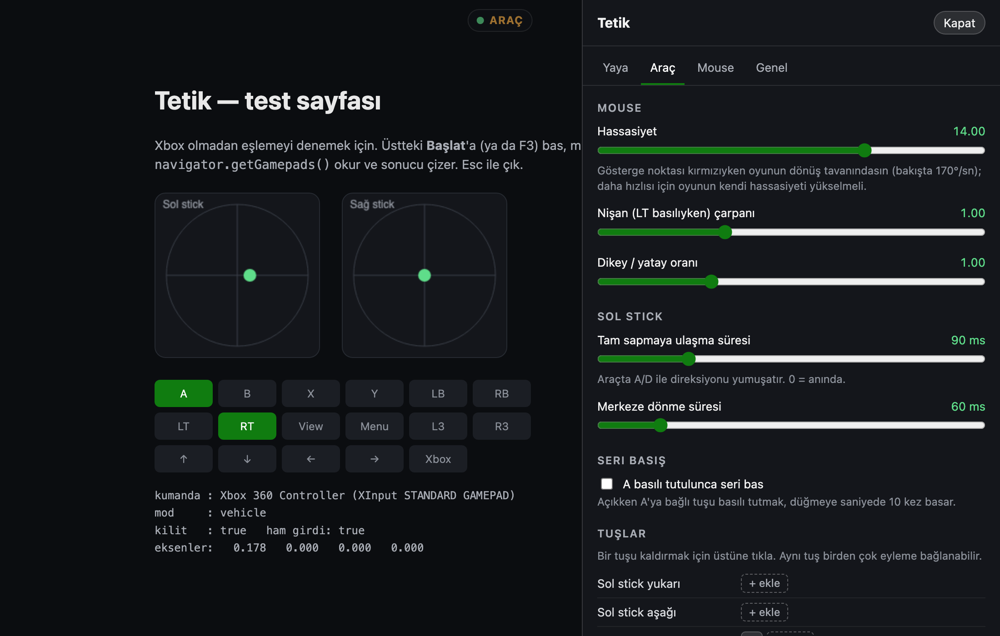
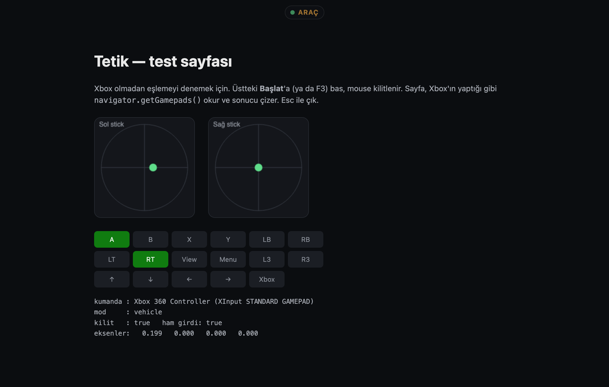
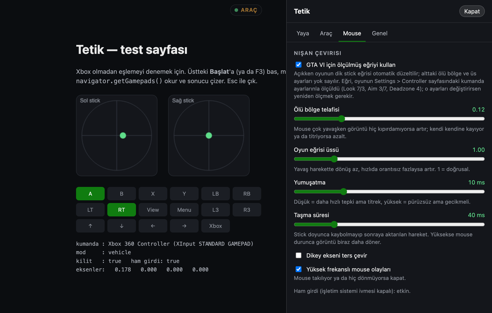

# Tetik

[English](README.md) · **Türkçe**

Xbox Remote Play ve Xbox Cloud Gaming'i tarayıcıda klavye ve mouse ile oynamanı sağlayan bir Chrome eklentisi. Sayfaya sanal bir Xbox kumandası gösterir ve klavye-mouse girdini stick ve düğme durumuna çevirir.

Tek bir derdi çözmek için yazıldı: GTA gibi oyunlarda `W` tuşu yürürken "sol stick ileri", arabadayken "sağ tetik (gaz)" olmalı. Düz bir tuş eşleyici hangisine ihtiyacın olduğunu bilemez.

> Resmî olmayan bir projedir. Microsoft, Xbox ya da Rockstar Games ile hiçbir bağlantısı yoktur. Tüm markalar sahiplerine aittir.



## Ne yapar

- **Yaya ve araç profilleri.** Her birinin kendi tuşları, mouse hassasiyeti ve direksiyon yumuşatması vardır. Profil değişince basılı tuşlar yeniden değerlendirilir; arabaya binerken `W` basılıysa tuşu bırakmadan gaza döner.
- **Otomatik araç algılama (GTA VI).** "Araca bin" düğmesi aynı zamanda "etkileşim / eşya topla" düğmesidir, bu yüzden eklenti tuşa basınca hemen mod değiştirmez. Yayın görüntüsünde, araca gerçekten oturduğunda mini haritanın üstünde çıkan araç adı kartını bekler ve o zaman geçer.
- **Mesafeyi koruyan mouse nişanı.** Mouse sayımları dönüş hızına çevrilir ve kullanılmayan sayımlar bir sonraki okumaya taşınır. Böylece aynı el hareketi aynı dönüş açısını verir (stick oyunun azami dönüş hızında doyana kadar).
- **Ölçülmüş tepki eğrileri.** Oyunlar sağ stick'e ölü bölge ve doğrusal olmayan bir eğri uygular. Eklenti GTA VI'da ölçülmüş eğrilerle gelir ve bunları tersine çevirir; serbest bakış ve nişan için ayrı eğriler, yatay ve dikey hız farkı için de düzeltme vardır.
- **Ham mouse girdisi.** Mouse kilidi `unadjustedMovement` ile istenir; işletim sisteminin imleç ivmesi devre dışı kalır.
- **Sayfa içi ayar paneli.** Tuşlar, hassasiyetler ve eğri seçenekleri yayın açıkken değiştirilebilir. Ayarlar JSON olarak dışa ve içe aktarılabilir.

## Ekran görüntüleri

Görüntüler oyundan değil, depoyla gelen test sayfasından alındı. Panel, yayının üstünde açılan panelle aynıdır.

| Araç profili: `W` sağ tetik, `Boşluk` el freni | Mouse çeviri ayarları |
|---|---|
|  |  |

## Kurulum

Mağaza kaydı yok; paketlenmemiş olarak yüklenir.

1. Bu depoyu indir ya da klonla.
2. `chrome://extensions` sayfasını aç ve **Geliştirici modu**nu etkinleştir.
3. **Paketlenmemiş öğe yükle**'ye bas ve depo klasörünü seç.
4. Xbox yayını için kullandığın başka klavye-mouse eklentisi varsa kapat. Kumanda arayüzünü aynı anda iki eklenti değiştirirse çakışırlar.
5. `https://www.xbox.com/play` ya da `https://play.xbox.com` adresini aç ve yayını başlat.

Chrome 111 ya da daha yenisi gerekir (ya da Manifest V3 `world: "MAIN"` içerik betiklerini destekleyen başka bir Chromium tarayıcısı).

## Kullanım

| Tuş | İşlev |
|---|---|
| `F3` | Yakalamayı başlatır ya da durdurur. Durdurmak yalnızca mouse'u serbest bırakır; sanal kumanda bağlı kalır. |
| `Esc` | Mouse'u serbest bırakır (tarayıcı davranışı). Tam ekranda oyuna Menü tuşu olarak gider. |
| `Alt+R` | Sanal kumandayı çıkarıp yeniden takar. Oyun "Controller Disconnected" gösterirse kullan. |
| `F` | Araca bin / in (Y gönderir). Araçtan inince yaya profiline anında geçilir. |
| `1` / `2` | Yaya / araç profiline zorlar. |
| `` ` `` | İki profil arasında elle geçiş yapar. |

Sayfanın üstündeki küçük gösterge etkin profili gösterir. Noktası kırmızıya döndüğünde stick doymuştur, yani oyunun azami dönüş hızındasın.

Varsayılan tuşlar GTA VI'nın varsayılan kumanda şemasını izler: `WASD` yürüme ya da sürüş, `Boşluk` zıplama / el freni, `Shift` koşma (sol stick tık), `Ctrl` çömelme, sol tık ateş, sağ tık nişan. Hepsi panelden değiştirilebilir.

## Sınırlar

- **Ayar paneli Türkçedir.** Çeviri katkıları memnuniyetle karşılanır.
- **Ölçülmüş eğriler belirli bir duruma özeldir.** GTA VI'da, Xbox Series X'te ve şu oyun içi kumanda ayarlarıyla ölçüldü: Look Sensitivity yatay 7 / dikey 3, Aim Sensitivity 3 / 7, Look Acceleration 7, Aim Acceleration 1, Aim Response Curve Standard, Right Stick Deadzone 4. Başka ayarlarda ya da başka oyunlarda panelden ölçülmüş eğriyi kapat ve elle ölü bölge ile üs kaydırıcılarını kullan.
- **Araç algılama yalnızca GTA VI içindir** ve varsayılan HUD yerleşimini varsayar. Yayın başladığında araçta olduğunu ya da araçtan fırladığını anlayamaz; bu durumlarda `1` / `2` tuşlarını kullan.
- **Yayın gecikmesi azalmaz.** Eklenti yalnızca girdi çevirisinden gelen tutarsızlığı giderir.
- **Oyunun azami dönüş hızı kesin bir tavandır.** Bundan hızlı mouse hareketi kırpılır.
- **Varsayılan mouse hassasiyeti düşük CPI'lı bir mouse'a göre ayarlıdır.** Görüntü fazla hızlı dönüyorsa panelden düşür.

## Nasıl çalışır

İçerik betikleri sayfanın ana dünyasında `document_start` anında çalışır ve `navigator.getGamepads()` çağrısını sarar; 0. yuva, o anki klavye ve mouse durumundan üretilen sanal bir kumanda döndürür.

| Dosya | Görev |
|---|---|
| `src/config.js` | Varsayılanlar, kayıtlı ayarların doğrulanması ve sürüm geçişi |
| `src/mouse.js` | Mouse'tan stick'e çeviri ve ölçülmüş eğriler |
| `src/mapper.js` | Basılı tuşlar ve etkin profilden kumanda durumu |
| `src/detect.js` | Yayın görüntüsünden araç adı kartının algılanması |
| `src/gamepad.js` | Sanal kumanda ve `getGamepads` sarmalayıcısı |
| `src/input.js` | Mouse kilidi, klavye ve mouse yakalama |
| `src/ui.js` | Gösterge ve ayar paneli |
| `src/main.js` | Parçaların birbirine bağlanması |

Ayarlar sayfanın `localStorage` alanında tutulur. Eklenti ağ isteği yapmaz ve veri toplamaz. Ayrıntı için [PRIVACY.md](PRIVACY.md) dosyasına bak.

## Geliştirme

Derleme adımı ve bağımlılık yoktur.

Birim testlerini çalıştırmak için (Node 20+):

```bash
node --test test/core.test.js
```

`test/tester.html` aynı betikleri düz bir sayfada yükler ve sanal kumandayı çizer; eşlemeler konsol olmadan denenebilir. Depo kökünü herhangi bir statik sunucuyla yayınla ve `/test/tester.html` adresini aç. Adrese `?demo=drive`, `?demo=panel` ya da `?demo=mouse` eklenirse sayfa yakalama etkinmiş gibi açılır; yukarıdaki ekran görüntüleri böyle alındı.

## Lisans

MIT. Ayrıntı için [LICENSE](LICENSE) dosyasına bak.
